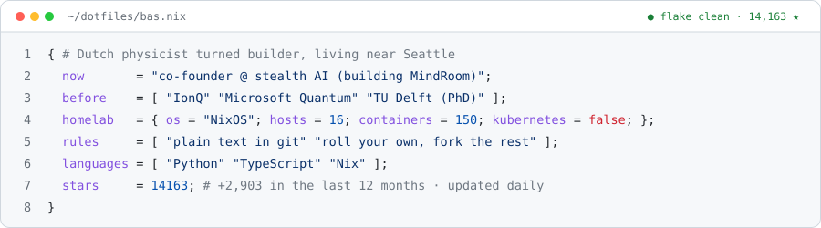

  <picture>
    <source media="(prefers-color-scheme: dark)" srcset="./hero_dark.svg" />
    <source media="(prefers-color-scheme: light)" srcset="./hero_light.svg" />
    
  </picture>

  <a href="https://www.nijho.lt/"><strong>nijho.lt</strong></a> &nbsp;·&nbsp;
  <a href="https://www.linkedin.com/in/basnijholt">LinkedIn</a> &nbsp;·&nbsp;
  <a rel="me" href="https://fosstodon.org/@basnijholt">Mastodon</a> &nbsp;·&nbsp;
  <a href="https://matrix.to/#/@basnijholt:mindroom.chat">Matrix</a> &nbsp;·&nbsp;
  <a href="https://scholar.google.com/citations?user=nIO4EK4AAAAJ&hl">Google Scholar</a>

I have a hard time not building things, and coding with AI agents has poured fuel on that fire. Almost everything on this GitHub started to scratch my own itch: syncing home lights with the sun, switching macOS apps in under 30 ms, running **15+ NixOS machines and ~150 containers** out of plain text files in git (zero Kubernetes), or orchestrating coding agents from a Matrix chatroom. Quite a few of those side quests ended up useful to other people too.

> [!TIP]
> **Currently obsessed with [MindRoom](https://github.com/mindroom-ai/mindroom):** AI agents that know you and your work, living as real users in Matrix rooms. Open source, any model, self-hosted or hosted.

## Selected Projects

<table>
  <tr>
    <td width="50%" valign="top">

**AI & Agents**

- **[mindroom-ai/mindroom](https://github.com/mindroom-ai/mindroom)** `★ 382` AI agents that live in Matrix rooms and know your work. Open source, any model.
- **[agent-cli](https://github.com/basnijholt/agent-cli)** `★ 239` Local voice dictation, TTS/STT servers, coding worktrees, and macOS app.

    </td>
    <td width="50%" valign="top">

**Scientific Python**

- **[python-adaptive/adaptive](https://github.com/python-adaptive/adaptive)** `★ 1.2k` Parallel active learning of mathematical functions.
- **[pipefunc/pipefunc](https://github.com/pipefunc/pipefunc)** `★ 481` Lightweight pure-Python DAG pipelines for scientific & HPC workflows.
- **[conda-incubator/unidep](https://github.com/conda-incubator/unidep)** `★ 243` Unified pip + conda dependency management in one command.
- **[adaptive-scheduler](https://github.com/basnijholt/adaptive-scheduler)** `★ 32` Massively parallel execution (&gt;10k-100k cores) on HPC clusters.

    </td>
  </tr>
  <tr>
    <td width="50%" valign="top">

**Home Automation**

- **[adaptive-lighting](https://github.com/basnijholt/adaptive-lighting)** `★ 3.6k` Home Assistant integration keeping your lights in sync with the sun.
- **[home-assistant-config](https://github.com/basnijholt/home-assistant-config)** `★ 2.0k` 100+ documented Home Assistant automations.
- **[home-assistant-streamdeck-yaml](https://github.com/basnijholt/home-assistant-streamdeck-yaml)** `★ 384` Control Home Assistant from a Stream Deck via YAML.

Also built and contributed to <a href="https://github.com/python-kasa/python-kasa">python-kasa</a>, <a href="https://github.com/basnijholt/aiokef">aiokef</a>, and <a href="https://github.com/basnijholt/miflora">miflora</a>.

    </td>
    <td width="50%" valign="top">

**Homelab & Dev Tools**

- **[compose-farm](https://github.com/basnijholt/compose-farm)** `★ 318` Multi-host Docker Compose over SSH. No agents, no Kubernetes.
- **[tuitorial](https://github.com/basnijholt/tuitorial)** `★ 529` Interactive terminal code tutorials & presentations.
- **[rsync-time-machine.py](https://github.com/basnijholt/rsync-time-machine.py)** `★ 410` Minimalist Time Machine-style backups with rsync.
- **[dotbins](https://github.com/basnijholt/dotbins)** `★ 272` Version-controlled CLI binaries across OSes & architectures.
- **[dotfiles](https://github.com/basnijholt/dotfiles)** `★ 166` NixOS, nix-darwin, and zsh powering &gt;15 machines.
- **[markdown-code-runner](https://github.com/basnijholt/markdown-code-runner)** `★ 137` Execute code blocks in-place to keep Markdown in sync.

    </td>
  </tr>
</table>

## GitHub Activity

  <picture>
    <source media="(prefers-color-scheme: dark)" srcset="./stars_dark.png" />
    <source media="(prefers-color-scheme: light)" srcset="./stars_light.png" />
    
  </picture>

Top 20 repositories by stars

1. [basnijholt/adaptive-lighting](https://github.com/basnijholt/adaptive-lighting/), 3,598 ⭐️s
2. [basnijholt/home-assistant-config](https://github.com/basnijholt/home-assistant-config/), 1,980 ⭐️s
3. [python-kasa/python-kasa](https://github.com/python-kasa/python-kasa/), 1,799 ⭐️s
4. [python-adaptive/adaptive](https://github.com/python-adaptive/adaptive/), 1,233 ⭐️s
5. [basnijholt/lovelace-ios-themes](https://github.com/basnijholt/lovelace-ios-themes/), 890 ⭐️s
6. [basnijholt/tuitorial](https://github.com/basnijholt/tuitorial/), 529 ⭐️s
7. [basnijholt/lovelace-ios-dark-mode-theme](https://github.com/basnijholt/lovelace-ios-dark-mode-theme/), 493 ⭐️s
8. [pipefunc/pipefunc](https://github.com/pipefunc/pipefunc/), 481 ⭐️s
9. [basnijholt/rsync-time-machine.py](https://github.com/basnijholt/rsync-time-machine.py/), 410 ⭐️s
10. [basnijholt/home-assistant-streamdeck-yaml](https://github.com/basnijholt/home-assistant-streamdeck-yaml/), 384 ⭐️s
11. [mindroom-ai/mindroom](https://github.com/mindroom-ai/mindroom/), 382 ⭐️s
12. [basnijholt/miflora](https://github.com/basnijholt/miflora/), 374 ⭐️s
13. [topocm/topocm_content](https://github.com/topocm/topocm_content/), 335 ⭐️s
14. [basnijholt/compose-farm](https://github.com/basnijholt/compose-farm/), 318 ⭐️s
15. [basnijholt/dotbins](https://github.com/basnijholt/dotbins/), 272 ⭐️s
16. [basnijholt/agent-cli](https://github.com/basnijholt/agent-cli/), 239 ⭐️s
17. [basnijholt/dotfiles](https://github.com/basnijholt/dotfiles/), 166 ⭐️s
18. [basnijholt/markdown-code-runner](https://github.com/basnijholt/markdown-code-runner/), 137 ⭐️s
19. [kwant-project/kwant](https://github.com/kwant-project/kwant/), 113 ⭐️s
20. [basnijholt/home-assistant-streamdeck-yaml-addon](https://github.com/basnijholt/home-assistant-streamdeck-yaml-addon/), 111 ⭐️s

## Latest Blog Posts

- `2026-11-23` · [I used to orchestrate agents. Now I orchestrate orchestrators. 🧵](https://www.nijho.lt/post/orchestrating-orchestrators/)
- `2026-11-20` · [Switching apps on macOS in under 30 ms ⚡](https://www.nijho.lt/post/macos-hotkey-app-switcher/)
- `2026-10-19` · [Roll your own, fork the rest 🍴](https://www.nijho.lt/post/roll-your-own-fork-the-rest/)
- `2026-10-18` · [Why Docker isn't an AI-safe sandbox anymore, and how I fixed it in MindRoom 🔒](https://www.nijho.lt/post/kernels-containers-vms/)
- `2026-10-11` · [Giving models the tools they were trained with can make them worse](https://www.nijho.lt/post/native-harness-tools/)
- `2026-10-08` · [How to start with AI](https://www.nijho.lt/post/how-to-start-with-ai/)
- `2026-10-02` · [Self-hosting AI does not save money, and I do it anyway](https://www.nijho.lt/post/self-hosting-ai-is-not-cheaper/)
- `2026-09-30` · [Slowly, then all at once: AI agents that know how a company works](https://www.nijho.lt/post/mindroom-at-ionq/)
- `2026-09-28` · [Friend-to-friend ZFS backups, version two](https://www.nijho.lt/post/zfs-tenant/)
- `2026-09-28` · [My declarative multi-machine homelab, explained](https://www.nijho.lt/post/homelab-explained/)
- `2026-09-23` · [Exploring the Jev hype in MindRoom](https://www.nijho.lt/post/jev-mindroom/)
- `2026-09-22` · [Frontier-level dictation on your iPhone keyboard, self-hosted](https://www.nijho.lt/post/diction-agent-cli-qwen/)
- `2026-09-22` · [Removing the guardrails and letting my coding agents loose](https://www.nijho.lt/post/removing-guardrails/)
- `2026-07-23` · [The last btrfs machine: migrating my PC to ZFS](https://www.nijho.lt/post/btrfs-to-zfs/)
- `2026-06-28` · [Migrating from TrueNAS to NixOS without losing data after the build-system rug pull](https://www.nijho.lt/post/truenas-to-nixos/)
All 46 posts at <a href="https://www.nijho.lt/post/">nijho.lt/post</a> · Updated automatically from <a href="https://www.nijho.lt/post/index.xml">RSS</a>.

---

Last updated 2026-11-24 · Generated automatically by <a href="./update-readme.ipynb">update-readme.ipynb</a> via <a href=".github/workflows/run-notebook.yml">GitHub Actions</a>.
